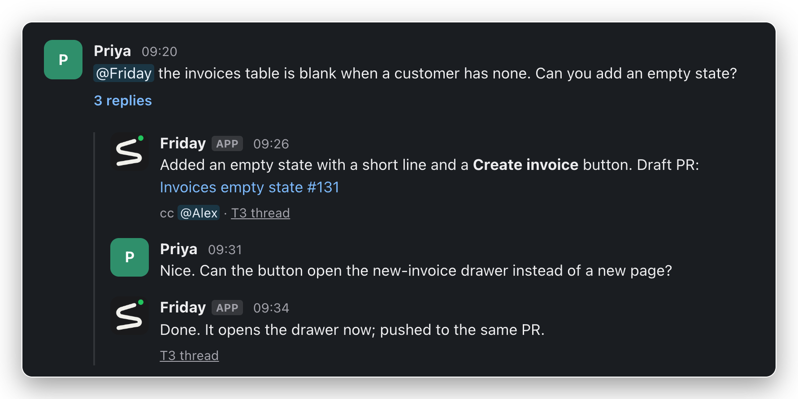

<p align="center"></p>

<h1 align="center">The coding agents on your Mac, in Slack</h1>

<p align="center">A Slack message becomes an agent run in its own worktree. The answer, or a draft PR, comes back to the thread.</p>

<p align="center">
  <a href="https://github.com/isacssw/serra/releases"></a>
  <a href="https://github.com/isacssw/serra/actions/workflows/ci.yml"></a>
  <a href="LICENSE"></a>
</p>

<p align="center"><br><sub>Demo workspace and data</sub></p>

> **Alpha** (latest: `0.1.0-alpha.7`). macOS on Apple silicon, Slack only, not notarized. Formats may change between
> versions. Read [Alpha limits](#alpha-limits) before you point it at a repository that matters.

- [What it does](#what-it-does) · [Quick start](#quick-start) · [Agent backends](#agent-backends) · [Knowledge](#knowledge)
- [Configuration](#configuration) · [Updating](#updating) · [Alpha limits](#alpha-limits) · [Troubleshooting](#troubleshooting) · [Uninstall](#uninstall) · [Development](#development)

## What it does

- **Requests from Slack.** Mention the bot or DM it; reply in the thread to keep going. 👀 means it saw the message.
- **And from your phone.** Connect a Telegram bot in **Settings › Channels** and message it from anywhere: same jobs,
  same knowledge, approval buttons included ([docs/telegram.md](docs/telegram.md)).
- **And from Discord.** Connect a Discord bot there too: mention it in a server and it works in a thread, or DM it
  ([docs/discord.md](docs/discord.md)).
- **A fresh worktree per job.** The agent works in a new Git worktree of your repository, as you, with your GitHub
  login and your agent's own sign-in. No server, no provider keys.
- **Careful by default.** The default brief asks for **draft** PRs and never to merge, force-push or touch production.
  Change it in **Settings › Brief & policy**.
- **Questions and approvals as cards.** When the agent asks something, the thread gets a card with buttons. The
  requester or the owner can answer; a permission request only the owner can.
- **Jobs in the app.** The menubar app lists what needs you, what's running and what finished today. Each job links to
  its Slack thread, its PR and its **Chat**: the run's messages as they stream, tool calls, approvals, images, and a
  box to answer or follow up. A run that failed shows as **Failed** with the reason, under **Needs you**.
- **Images both ways.** A screenshot sent in Slack reaches the agent; an image the agent saves and names in its reply
  is uploaded to the thread and shown in Jobs › Chat.
- **Pluggable agents.** T3 Code by default, or Claude Code, Codex, OpenCode, Gemini CLI or any ACP agent you add.
- **A knowledge base it learns.** Pages about you and how you work, which every job reads. Nothing is added without
  your approval.
- **Beyond mentions.** Optional alert channels it investigates on its own, tasks started from the app (**New task**),
  and meeting notes turned into proposals ([docs/meetings.md](docs/meetings.md)).

Each engineer runs their own bot: their own Slack app, their own Mac, their own GitHub login.

The bot can also run on a Linux machine, without the app, and the app can pair with it: [docs/linux.md](docs/linux.md).

## Quick start

### What you need

| What | Why | Check |
|---|---|---|
| A Mac with Apple silicon | Only an `arm64` build is published. On Intel, [build it yourself](CONTRIBUTING.md#build-the-app). | Apple menu › About This Mac |
| [T3 Code](https://github.com/pingdotgg/t3code) running, with a provider signed in | The default backend. Serra starts T3 threads through the `t3` command line (default `~/.t3/bin/t3`). Setup and Diagnostics check it even if you then pick an [ACP agent](#agent-backends). | `~/.t3/bin/t3 thread list --project /path/to/repo --json` |
| Node.js 24+, or 22.18+ on the 22 line, with pnpm | The app builds and runs the background bot with your Node. | `node -v`, `pnpm -v` (`corepack enable pnpm` if missing) |
| Git and the GitHub CLI, signed in | The agent commits, pushes and opens PRs as you. | `gh auth status` |
| Permission to create a Slack app | Each bot is its own Slack app. | — |

Your repository must be a Git checkout with a remote (normally `origin` on GitHub), added as a project in T3 Code,
with Git `user.name` and `user.email` set.

### 1. Get the app

1. Open [GitHub Releases](https://github.com/isacssw/serra/releases). Every alpha is a **pre-release**: take the newest
   at the top (today `v0.1.0-alpha.7`), not one GitHub labels "Latest".
2. Download `Serra-<version>-arm64.dmg` and `SHA256SUMS` into the same folder.
3. Check the download:

   ```sh
   cd ~/Downloads
   shasum -a 256 -c SHA256SUMS --ignore-missing
   ```

   You want `Serra-<version>-arm64.dmg: OK`. Anything else: delete it and download again.

### 2. Install it

1. Open the `.dmg`, drag **Serra** to **Applications**, eject the disk image.
2. Open Serra. It isn't notarized, so macOS blocks the first launch. Allow it once:
   - **macOS 15 or later:** **Done** on the warning, then **System Settings › Privacy & Security** › **Open Anyway**.
   - **macOS 14 or earlier:** Control-click Serra in Applications › **Open** › **Open**.

Serra lives in the menubar. If macOS says the app "is damaged", see
[docs/app/install.md](docs/app/install.md#first-launch-past-gatekeeper).

### 3. First run

Serra opens on setup until it's done. It finds any existing profile (from `pnpm run setup`, an older app, or a setup
left halfway) and resumes at the first missing step.

| Step | What it asks for |
|---|---|
| **You & repo** | Your name, GitHub login and Slack member ID (Slack › your picture › **Profile** › **⋮** › **Copy member ID**), the repository folder, and the bot's name. |
| **Connect Slack** | **Create in Slack** opens Slack's "create from manifest" page with your manifest filled in. Install it, then paste the bot token (`xoxb-…`) and the app-level token (`xapp-…`, scope `connections:write`). They go to the Keychain, or 1Password or `.env` if you choose. |
| **Confirm you** | Nothing to type: Slack checks your member ID. |
| **Install and start** | Runs every check, installs the bot as a launchd service, and waits until it answers. If a check fails, nothing is installed. |

Then invite the bot to a test channel (`/invite @friday`) and ask `@friday what does this repository do?`.

If something fails, **Settings › Diagnostics** lists failing checks first, each with a button to the fix. Setup stays
under **Serra › Set Up Serra…** and ⌘K. Full setup details: [docs/app/install.md](docs/app/install.md#setup).

## Agent backends

Pick one in **Settings › Worker › Agent**; it applies to the next job, and a running job keeps the one it started on.

| Backend | What you need |
|---|---|
| **T3 Code** (default) | T3 running with a provider signed in. Provider and model under **Settings › Worker**. |
| Claude Code | `claude` installed and signed in. Serra ships the ACP adapter. |
| Codex | `codex` installed and signed in. Serra ships the ACP adapter. |
| OpenCode | `opencode` on your `PATH`. |
| Gemini CLI | `gemini` on your `PATH`. |
| Your own | Any command that speaks the [Agent Client Protocol](https://agentclientprotocol.com) over stdio. |

Add your own with **Add ACP agent** on the same screen, or in the profile's `agent-backend.json`:

```json
{ "agents": [{ "id": "my-agent", "name": "My agent", "command": "my-agent", "args": ["acp"], "env": {} }] }
```

An agent bound to one app, such as [eve](https://eve.dev), takes a `cwd` (an absolute path). Serra then starts it in
that folder and runs every job there instead of a worktree, and every approval waits for a person.

How ACP runs differ from T3 (restarts, steering, permissions, images): [docs/agent-backends.md](docs/agent-backends.md).

## More than one bot

Each bot is a **profile**: its own Slack app, knowledge, agent, settings and service. To add one, click the name at the
top of the sidebar, or press ⌘⇧N, and pick **Add…**: a name, a colour and an agent, then the usual setup.

With two or more, the top row shows the bot you're looking at. Its menu, ⌘1…⌘9 and ⌘K switch; every screen then
shows only that bot. Each bot keeps running in the background whichever one you look at, and the app follows all of
them live: the switcher shows each one's state, the menubar lists every bot (open it, start a task, restart or stop it)
with its icon showing the worst state, notifications say which bot they're from, and Jobs shows a quiet line when
another bot needs you. Each bot also follows the app's updates on its own. **Settings › Profiles**
sets the order (which is ⌘1…⌘9) and colours, and **Remove** stops a bot, saves a checked backup in
`~/.local/share/serra/backups/` (tokens are left out) and moves its folder to the Trash. Its Slack app stays in Slack.

## Knowledge

The bot keeps a small knowledge base in the profile's `knowledge/`. Every job's brief carries what its audience may
hear (`audience: owner | team | external`).

- **Knowledge › Proposals › Start interview**: the agent interviews you about your role, workflows and limits. Each
  summary you confirm becomes a proposal; approved, it becomes a page. [docs/knowledge-interview.md](docs/knowledge-interview.md)
- **Overview**: how many pages you have, how many replies they shaped, their health, and a **Needs you** list.
- **Graph**: your pages as a map, an island per area.
- **About me** and **Pages**: what jobs know about you, and every page with who may hear it.
- A **weekly review** suggests fixes; nothing changes until you approve. [docs/knowledge-health.md](docs/knowledge-health.md)

## Configuration

Most settings are in the app. Each bot has one private profile folder, `~/.local/share/serra/<bot-id>/`:

| File | What it holds |
|---|---|
| `profile.json` | Bot name and ID, owner, repositories, allowed people, worker, alert triggers |
| `secrets.json`, `.env` | Where each Slack (and Telegram, Discord) token comes from (Keychain, 1Password), or the tokens themselves in `.env` |
| `brief.md`, `policy.md` | The instructions every job gets, and your own rules |
| `knowledge/` | Knowledge pages and pending proposals |
| `agent-backend.json`, `agent-runs/` | The backend you picked, models, custom agents, and each ACP run's transcript |
| `attachments/` | Images and files sent to the bot in Slack |
| `state.json`, `logs/` | Job state and logs (`logs/bot.log`) |
| `telegram/`, `discord/` | Telegram's and Discord's threads as Serra saw them, and a pairing code while one waits |

| Settings screen | What it changes |
|---|---|
| Bot & Slack, Channels, People, Repositories | The bot's name, Telegram and Discord, who may ask it, and the repositories it works in |
| Worker | The agent backend, model, branch names, and developer updates |
| Alerts | Channels whose messages it investigates without a mention (`messageTriggers`) |
| Brief & policy, Meetings | Its instructions, and meeting capture (off by default) |
| Secrets, Tools | Where the Slack tokens are, and the MCP servers and CLIs jobs will have |
| Profiles, Appearance, Updates, Diagnostics | The app itself: your bots' order and colours, and more |

Other places: Slack tokens in the Keychain (service `dev.serra.<bot-id>`), the service at
`~/Library/LaunchAgents/dev.serra.<bot-id>.plist`, the app's preferences in
`~/Library/Application Support/serra/prefs.json`, and the order and colours of your bots in
`~/.local/share/serra/profiles.json` (written only once you change one). Every field and file: [docs/configuration.md](docs/configuration.md).
Include the profile in your private backups.

## Updating

**On alpha.3 or later**, Serra updates itself from GitHub Releases: **Settings › Updates** › **Download**, checked
against `SHA256SUMS`, then **Restart to update**. The background bot moves to the new version once no job is running;
new requests wait (⌛) until it's back.

**On alpha.2 or older**, install the latest release by hand once: quit Serra (⌘Q in its window), then
[get](#1-get-the-app) and [install](#2-install-it) it, choosing **Replace**. Updates are automatic from then on.

Replacing the app keeps your profile, tokens and service. Running Serra from a checkout (`pnpm run setup`,
`pnpm bot activate`)? Open the app: setup finds your profile and the bot moves onto the app's version. More:
[docs/app/install.md](docs/app/install.md#updates).

## Alpha limits

- macOS and Slack only, and only an Apple silicon build is published. One bot per Slack app. On Linux the bot runs
  from a checkout, without the app ([docs/linux.md](docs/linux.md)).
- The bot acts with **your** GitHub login and your agent's sign-in. Anyone on the allowed list can have it read your
  repository and open PRs as you. Keep the list short.
- Your Mac and T3 Code must stay on. Messages sent while the bot is down aren't replayed.
- The app is ad-hoc signed and not notarized.
- The profile and state formats may change between alphas; the [CHANGELOG](CHANGELOG.md) says when.

## Troubleshooting

Start with **Settings › Diagnostics**.

- **"Serra can't be opened" or "is damaged":** allow it as in [Install it](#2-install-it). If it says damaged, download
  again and check `SHA256SUMS`; `xattr -dr com.apple.quarantine /Applications/Serra.app` clears the download flag.
- **Tokens FAIL / `invalid_auth`:** both tokens must come from the same Slack app; `xoxb-` for the bot, `xapp-` with
  `connections:write` for the app. Reinstall the Slack app after changing scopes.
- **No reply in Slack:** is the bot in the channel? Are you the owner or in **Settings › People**? See `logs/bot.log`.
- **T3 checks FAIL:** start T3 and add the exact repository folder as a T3 project. Set `t3Bin` in `profile.json` if
  `t3` lives elsewhere.
- **An ACP job shows Failed:** Jobs › Chat says why (a sign-in, a usage limit). Fix it, then follow up in the thread.
- **"No supported Node" or "neither pnpm nor corepack":** install Node 24+ (or 22.18+), then `corepack enable pnpm`.
- **Service stops naming `~/Documents`, `~/Desktop` or `~/Downloads`:** allow `node` under Privacy & Security › Files
  and Folders, or keep the repository elsewhere.
- **Wrong profile, or none:** `open -a Serra --args --profile "$HOME/.local/share/serra/<bot-id>"`.

## Uninstall

```sh
BOT=friday                                                  # your bot ID (the profile's folder name)
launchctl bootout "gui/$(id -u)/dev.serra.$BOT"             # stop the background service
rm -f "$HOME/Library/LaunchAgents/dev.serra.$BOT.plist"
security delete-generic-password -s "dev.serra.$BOT" -a SLACK_BOT_TOKEN   # only if you used the Keychain
security delete-generic-password -s "dev.serra.$BOT" -a SLACK_APP_TOKEN
rm -rf "$HOME/.local/share/serra/$BOT"                      # the profile: settings, knowledge, state
```

Then quit Serra (⌘Q), move it to the Trash, remove `~/Library/Application Support/serra/`, and delete the Slack app at
[api.slack.com/apps](https://api.slack.com/apps). If you set `serviceLabel` in `profile.json`, use it instead of
`dev.serra.$BOT`. Worktrees stay behind: `git worktree list`, then `git worktree remove <path>` (ACP jobs make theirs
under `~/.serra/worktrees/`).

## Development

```sh
corepack enable pnpm
pnpm install --frozen-lockfile
pnpm check      # types, then lint
pnpm test       # no Slack, T3 or network needed
pnpm app:dev    # build and run the app
```

Running a bot from the checkout, building the `.dmg` and developer-mode updates: [CONTRIBUTING.md](CONTRIBUTING.md#development-setup).
Releases: [docs/releasing.md](docs/releasing.md). Security issues: [SECURITY.md](SECURITY.md).

Serra is released under the [MIT License](LICENSE). It isn't affiliated with Slack, T3 Code or any agent vendor.
