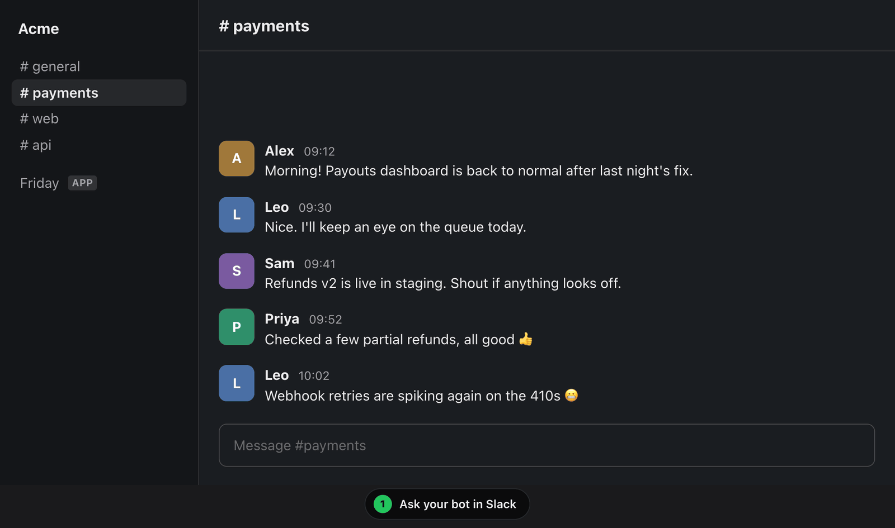
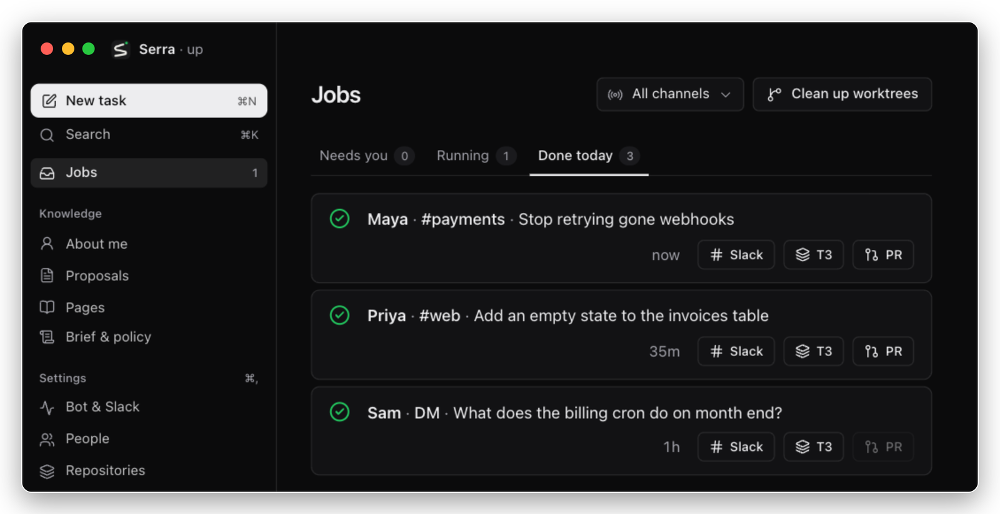

<p align="center"></p>

<h1 align="center">The coding agents on your Mac, in Slack</h1>

<p align="center">A message becomes a T3 task in its own worktree. A draft PR comes back to the thread.</p>

<p align="center">
  <a href="https://github.com/isacssw/serra/releases"></a>
  <a href="https://github.com/isacssw/serra/actions/workflows/ci.yml"></a>
  <a href="LICENSE"></a>
</p>

<p align="center"><br><sub>Demo workspace and data</sub></p>

- **Ask from Slack.** Mention the bot or DM it. Reply in the thread to keep going.
- **Your Mac, your logins.** The agent you run in T3 Code (Claude, Codex, …) works in a fresh worktree of your repository. No server, no provider keys.
- **Careful by default.** The default brief tells the agent to open draft PRs and never merge, force-push or touch production. Tune it in **Brief & policy**.

**[Download for Mac](https://github.com/isacssw/serra/releases)** (Apple silicon)<br>
Needs [T3 Code](https://github.com/pingdotgg/t3code) running, Node 24+ (or 22.18+ on 22.x) with pnpm, the GitHub CLI signed in, and permission to create a Slack app. [Full list](#what-you-need)

> **Alpha.** Not notarized: macOS blocks the first launch until you [allow it once](#2-install-it). Slack only. Expect rough edges and breaking changes; read [Alpha limits](#alpha-limits) before using it on a repository that matters.

<p align="center"><br><sub>Follow up in the thread</sub></p>

<p align="center"><br><sub>Every job, one click from its Slack thread, T3 task and PR</sub></p>

## How it works

Serra is a bridge between your team chat and the coding agents on your Mac. It connects a chat bot to [T3 Code](https://github.com/pingdotgg/t3code), so the agent you already use there (Claude, Codex, …) can take requests from chat. When someone mentions the bot or sends it a DM, Serra starts a T3 thread in a fresh Git worktree of your repository. The agent does the work there (answers a question, fixes a bug, opens a draft PR) and its reply goes back to the chat thread.

Slack is the only chat channel in this alpha; others are planned. Each engineer runs their own bot: their own Slack app, their own Mac, their own GitHub login.

- **New here?** [What you need](#what-you-need) → [Get the app](#1-get-the-app) → [Install it](#2-install-it) → [First run](#3-first-run).
- **On the Serra app, alpha.2 or older?** [Install the latest release by hand once](#updating); it updates itself after that.
- **Running Serra from a checkout?** [Move to the app](#from-serra-run-from-a-checkout-pnpm-run-setup-pnpm-bot-activate).
- **Coming from another self-hosted bot?** [Migrate](#from-another-self-hosted-bot-not-serra).

- [What you need](#what-you-need)
- [1. Get the app](#1-get-the-app) · [2. Install it](#2-install-it) · [3. First run](#3-first-run) · [4. Teach it how you work](#4-teach-it-how-you-work-optional)
- [Updating](#updating)
- [Migrating from an older setup](#migrating-from-an-older-setup)
- [How it behaves in Slack](#how-it-behaves-in-slack)
- [Where things live](#where-things-live)
- [Alpha limits](#alpha-limits) · [Troubleshooting](#troubleshooting) · [Uninstall](#uninstall) · [Develop](#develop)

## What you need

| What | Why | Check |
|---|---|---|
| A Mac with Apple silicon | The released app is Apple silicon only for now. On an Intel Mac, [build it yourself](CONTRIBUTING.md#build-the-app). | Apple menu › About This Mac |
| [T3 Code](https://github.com/pingdotgg/t3code) running, with its `t3` command line | Serra starts and reads T3 threads through it. Default path `~/.t3/bin/t3`. | `~/.t3/bin/t3 thread list --project /path/to/repo --json` |
| A coding provider signed in inside T3 Code (Claude, Codex, …) | T3 runs the actual agent. Serra doesn't ask for provider keys. | Start a thread in T3 by hand |
| Node.js 24+, or 22.18+ on the 22 line, with pnpm | The app builds and runs the background bot with your Node. Get pnpm with `corepack enable pnpm`, or `npm install -g pnpm@10` if your Node has no Corepack. | `node -v`, `pnpm -v` |
| Git and the GitHub CLI, signed in | The agent commits, pushes and opens PRs as you. | `gh auth status` |
| Permission to create a Slack app in your workspace | Each bot is its own Slack app. Ask an admin if app approval is required. | — |

Your repository must be a Git checkout with a remote (normally `origin` on GitHub), added as a project in T3 Code, with Git `user.name` and `user.email` set.

## 1. Get the app

1. Open [GitHub Releases](https://github.com/isacssw/serra/releases). During the alpha every release is a **pre-release**, so take the newest one at the top (not the one GitHub labels "Latest", if any).
2. Download `Serra-<version>-arm64.dmg` and `SHA256SUMS` into the same folder.
3. Check the download (optional, recommended):

   ```sh
   cd ~/Downloads
   shasum -a 256 -c SHA256SUMS --ignore-missing
   ```

   You want `Serra-<version>-arm64.dmg: OK`. Anything else: delete the file and download it again.

## 2. Install it

1. Open the `.dmg` and drag **Serra** to **Applications**. Eject the disk image.
2. Open Serra. The app isn't notarized yet, so macOS blocks the first launch. Allow it **once**:
   - **macOS 15 or later:** click **Done** on the warning, open **System Settings › Privacy & Security**, scroll down to "Serra was blocked…" and click **Open Anyway**, then confirm.
   - **macOS 14 or earlier:** Control-click (right-click) Serra in Applications, choose **Open**, then **Open** again.

Serra lives in the menubar. Details, and what to do if macOS says the app "is damaged": [docs/app/install.md](docs/app/install.md#first-launch-past-gatekeeper).

## 3. First run

Until setup is done, Serra opens on its own full-window setup: a short welcome, then four steps. You can leave at any point (**Skip for now** appears once the profile exists) and come back from the sidebar's **Finish setup** row, ⌘K, or **Serra › Set Up Serra…** in the menu bar. Finished steps stay done, and a half-typed form is kept.

If you already have a profile (from `pnpm run setup`, an older app, or a setup left halfway), Serra finds it, shows what it already has (for example "2 tokens found in .env") and picks up at the first missing step. With several profiles, it asks which one; **Open another profile…** picks a folder elsewhere.

| Step | What it asks for | Where to find it |
|---|---|---|
| 1. You & repo | Your name, GitHub login and **Slack member ID**, the repository folder (**Choose…**), and the bot's name (e.g. `Friday`). Your name, GitHub login, base branch and GitHub repo are filled in when Serra can find them. | Member ID: in Slack, click your picture › **Profile** › **⋮** › **Copy member ID** (looks like `U0123456789`). |
| 2. Connect Slack | **Create in Slack** opens Slack's "create from manifest" page with your bot's manifest filled in. Create it and **Install to Workspace**, then paste the **bot token** (`xoxb-…`) and the **app-level token** (`xapp-…`); each is stored in the Keychain and checked with Slack. Tokens already in `.env` or the Keychain are checked for you. **Use 1Password or .env instead** offers the other sources. | Bot token: your app › **Install App** (or **OAuth & Permissions**). App token: **Basic Information › App-Level Tokens** › Generate, with the `connections:write` scope. |
| 3. Confirm you | Nothing to type: Slack looks up your member ID with the bot token, so a typo shows now. | — |
| 4. Install and start | Runs every check, then installs and starts the bot as a background service (launchd), and waits until it answers. If a check fails, nothing is installed and it tells you what to fix. | — |

Setup doesn't ask for Claude or Codex keys: the bot uses whatever provider is signed in inside T3 Code. Settings › **Tools** shows which providers and MCP servers the jobs will have.

Then try it: invite the bot to a test channel (`/invite @friday`) and ask `@friday what does this repository do?`. You get 👀, then an answer in the thread. Reply in the thread to continue.

If something fails, open **Settings › Diagnostics**: each check says PASS or FAIL with the fix. Setup stays under **Serra › Set Up Serra…** and **Diagnostics › Setup**.

## 4. Teach it how you work (optional)

Open **Knowledge › Proposals › Start interview**. A T3 thread interviews you, one question at a time, about your role, workflows and limits. Each summary you confirm becomes a proposal; approve it in **Proposals** and it becomes a knowledge page every job can read. **Knowledge › About me** shows what jobs know about you. More: [docs/knowledge-interview.md](docs/knowledge-interview.md).

## Updating

**On v0.1.0-alpha.3 or later:** Serra updates itself from GitHub Releases (pre-releases included while you're on an alpha). It checks on its own every few hours.

1. **Settings › Updates** › **Check for updates** (or wait), then **Download**. The download is verified against `SHA256SUMS`.
2. **Restart to update**. If Serra can't replace itself (for example it runs from the disk image), it offers **Open installer**: drag the new copy to Applications.
3. The background bot moves to the new version on its own once no job is running. New requests wait (⌛) until it's back. A bot you stopped stays stopped: **Update now** on the same screen moves it.

**Upgrading from alpha.2 or older:** alpha.2 can't find new versions, so install the latest release by hand, one last time. Open the Serra window and press **⌘Q** (closing the window doesn't quit; the bot keeps running), then do [Get the app](#1-get-the-app) and [Install it](#2-install-it), choosing **Replace**. macOS asks to allow it once more. Nothing to delete or set up again: the bot moves to the new version on its own once no job is running, and from then on updates are automatic. If alpha.2's **Update source** is set, Serra clears it shortly after launch when it can't work; otherwise Updates offers **Follow app updates**.

**What a reinstall or update keeps.** Your bot's data lives outside the app, so replacing `Serra.app` keeps it. The bot keeps running while the app is replaced; its switch to the new version then rewrites the service file and removes all but the last two bot builds in `releases/`.

| What | Where |
|---|---|
| Your bot's profile: settings, knowledge, brief and policy, job state, logs | `~/.local/share/serra/<bot-id>/` |
| Slack tokens | macOS Keychain (by default service `dev.serra.<bot-id>`), your 1Password vault, or the profile's `.env` |
| Which profile the app opens, window preferences | `~/Library/Application Support/serra/prefs.json` |
| The background service | `~/Library/LaunchAgents/dev.serra.<bot-id>.plist` (the default label) |

## Migrating from an older setup

### From Serra run from a checkout (`pnpm run setup`, `pnpm bot activate`)

Your profile already works with the app; there's nothing to copy.

1. [Get](#1-get-the-app) and [install](#2-install-it) the app.
2. Open it. Setup finds your profiles under `~/.local/share/serra/` and shows what each already has; pick yours (or **Open another profile…** if it lives elsewhere). Tokens in `.env` are checked, not asked for again, and setup continues at the first step still missing.

3. **Service already installed** (`pnpm bot activate`): it's kept. When no job is running, the app moves the bot onto the app's own code and version, and from then on it follows the app's updates. You no longer need `git pull` and `pnpm bot prepare`/`activate`. If the profile has an update source (`updates` in `profile.json`), clear **Settings › Worker › Developer: update from a checkout** first.
4. **Only ran it in a terminal** (`pnpm start`): stop that copy (Ctrl-C), then finish the remaining steps in setup (the sidebar's **Finish setup**); the last one installs the service.

To keep running the bot from your checkout instead (to work on Serra), set **Settings › Worker › Developer: update from a checkout**. See [CONTRIBUTING.md](CONTRIBUTING.md#update-a-bot-from-your-checkout).

### From another self-hosted bot (not Serra)

There is no importer: Serra can't read another bot's config, state or memory. Set up Serra fresh with the [first run](#3-first-run), then bring over what you need by hand:

| What you had | How to bring it over |
|---|---|
| **Slack app** | Easiest: let setup create a **new** Slack app, then retire the old bot. To reuse your old app: stop the old bot first (two programs on one Socket Mode app split the messages between them). In **Connect Slack**, click **Copy manifest** instead of Create in Slack, paste it over your app's manifest (your app › **App Manifest**), reinstall the app, then paste its two tokens below. |
| **Owner, allowed users, repositories** | Enter them in setup, then **Settings › People** and **Settings › Repositories**. They are the `owner`, `allowedUsers` and `repositories` fields of `profile.json` ([all fields](docs/configuration.md#profile-format)). |
| **Model and provider** | **Settings › Worker** (`worker.provider`, `worker.model`). |
| **Instructions / system prompt** | Put your own rules in **Brief & policy** (`policy.md` in the profile). Keep the generated `brief.md`; it holds Serra's safety rules. |
| **About-me / memory / knowledge notes** | Two ways. Run the [interview](#4-teach-it-how-you-work-optional) with your old notes at hand. Or save each note as a Markdown file in `<profile>/knowledge/proposals/`, with the page header described in [knowledge/README.md](templates/knowledge/README.md) (start with `audience: owner`, so only you hear it), and click **Add page** on each one in **Knowledge › Proposals**. |
| **Thread history, open conversations, scheduled jobs** | Not carried over. Serra starts with empty job state. |

## How it behaves in Slack

- 👀 means it saw your message; it goes away when the bot answers. A long job gets one "Still on it" line.
- Clarifying questions appear in the thread with buttons. The requester or the owner can answer.
- The owner is pinged only when the bot is blocked on something only they can do.
- By default it opens **draft** PRs, never merges, never force-pushes, and won't touch production or shared systems. The rules are in **Brief & policy**.

## Where things live

Each bot has one private **profile** folder, `~/.local/share/serra/<bot-id>/`:

| File | What it holds |
|---|---|
| `profile.json` | Bot name and ID, owner, repository, allowed users, extra repositories, alert triggers |
| `secrets.json`, `.env` | Where each Slack token comes from (Keychain, 1Password), or the tokens themselves in `.env` |
| `brief.md`, `policy.md` | The instructions every job gets, and your own rules |
| `knowledge/` | Your knowledge pages and pending proposals |
| `state.json`, `logs/` | Job state and logs (`logs/bot.log`) |

Every field and file: [docs/configuration.md](docs/configuration.md). Include the profile in your private backups.

## Alpha limits

- Slack only, macOS only, and only an Apple silicon build is published. One bot per Slack app.
- The bot acts with **your** GitHub credentials and your T3 Code provider. Anyone on the allowed list can ask it to read your repository and open PRs as you. Keep the list short.
- Your Mac and T3 Code must stay on for the bot to answer. Messages sent while it's down aren't replayed.
- The app is ad-hoc signed and not notarized.
- Formats (profile, state) may change between alpha versions; check the [CHANGELOG](CHANGELOG.md).

## Troubleshooting

Start with **Settings › Diagnostics**: most problems show up as a FAIL with the fix.

- **"Serra can't be opened":** allow it once, as in [Install it](#2-install-it).
- **"Serra is damaged":** download the `.dmg` again, [check it](#1-get-the-app), and copy Serra from it again. If it still says so, `xattr -dr com.apple.quarantine /Applications/Serra.app` clears the download flag.
- **Tokens FAIL / `invalid_auth`:** both tokens must come from the same Slack app; the bot token starts `xoxb-`, the app token `xapp-` with `connections:write`. Reinstall the Slack app after changing scopes.
- **No reply in Slack:** is the bot invited to the channel? Are you the owner or in **Settings › People**? Check `logs/bot.log` in the profile.
- **T3 checks FAIL:** start T3 Code and add the exact repository folder from step 1 as a T3 project. If `t3` lives elsewhere, set its path in setup (**More options**) or `t3Bin` in `profile.json`.
- **"No supported Node" or "neither pnpm nor corepack":** install Node 24+ (or 22.18+) and run `corepack enable pnpm`, or `npm install -g pnpm@10`.
- **GitHub account FAIL:** `gh auth login` as the login in your profile.
- **Service stops at start, naming `~/Documents`, `~/Desktop` or `~/Downloads`:** allow `node` under System Settings › Privacy & Security › Files and Folders, or keep the repository elsewhere (e.g. `~/code`).
- **The app opened the wrong profile, or none:** `open -a Serra --args --profile "$HOME/.local/share/serra/<bot-id>"`.

## Uninstall

Set your bot ID first (the profile's folder name), then:

```sh
BOT=friday                                                  # your bot ID
launchctl bootout "gui/$(id -u)/dev.serra.$BOT"             # stop the background service
rm -f "$HOME/Library/LaunchAgents/dev.serra.$BOT.plist"
security delete-generic-password -s "dev.serra.$BOT" -a SLACK_BOT_TOKEN   # only if you used the Keychain
security delete-generic-password -s "dev.serra.$BOT" -a SLACK_APP_TOKEN
rm -rf "$HOME/.local/share/serra/$BOT"                      # the profile: settings, knowledge, state
```

Then quit Serra (⌘Q), move it to the Trash, remove `~/Library/Application Support/serra/`, and delete the Slack app at [api.slack.com/apps](https://api.slack.com/apps). If you changed the service label (`serviceLabel` in `profile.json`), use that instead of `dev.serra.$BOT`.

Worktrees the bot made stay in your repository: `git worktree list`, then `git worktree remove <path>`.

## Develop

Running Serra from a checkout without the app, building the `.dmg`, developer-mode updates and running the tests are in [CONTRIBUTING.md](CONTRIBUTING.md#development-setup). Report security issues privately as described in [SECURITY.md](SECURITY.md).

Serra is released under the [MIT License](LICENSE). It isn't affiliated with Slack, T3 Code or any other chat or agent vendor.
